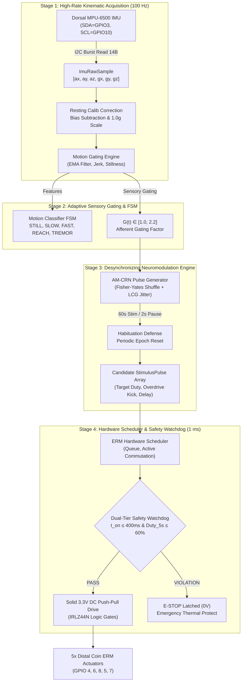

# AM-CRN Software Architecture & IMU Calibration Guide

Comprehensive technical documentation of the embedded software pipeline, dorsal 6-axis IMU calibration routines, closed-loop kinematic gating mathematics, FreeRTOS scheduler, and fail-safe safety watchdogs for the **Adaptive Motion-Gated Coordinated Reset Neuromodulation (AM-CRN) Glove**.

---

## 📑 Table of Contents
1. [Software System Architecture](#1-software-system-architecture)
2. [C99 / FreeRTOS Core Modules](#2-c99--freertos-core-modules)
   - [2.1 Motion Gating Engine (`motion_gating_engine.c`)](#21-motion-gating-engine-motion_gating_enginec)
   - [2.2 Neuromodulation Engine (`neuromodulation_engine.c`)](#22-neuromodulation-engine-neuromodulation_enginec)
   - [2.3 Hardware Scheduler & Safety Watchdogs (`erm_hardware_scheduler.c`)](#23-hardware-scheduler--safety-watchdogs-erm_hardware_schedulerc)
   - [2.4 Master System Orchestrator (`am_crn_system.c`)](#24-master-system-orchestrator-am_crn_systemc)
3. [Dorsal 6-Axis IMU Calibration Protocol](#3-dorsal-6-axis-imu-calibration-protocol)
   - [3.1 Hardware Wiring & Pin Configuration](#31-hardware-wiring--pin-configuration)
   - [3.2 Sensor Register Configuration & DLPF Tuning](#32-sensor-register-configuration--dlpf-tuning)
   - [3.3 Non-Blocking I2C Probing (Lockup Prevention)](#33-non-blocking-i2c-probing-lockup-prevention)
   - [3.4 Resting 6-Axis Calibration Algorithm](#34-resting-6-axis-calibration-algorithm)
   - [3.5 Real-Time Kinematic Verification](#35-real-time-kinematic-verification)
4. [Actuator Commutation & Gate Drive Strategy](#4-actuator-commutation--gate-drive-strategy)
   - [4.1 IRLZ44N Logic-Level MOSFET Commutation](#41-irlz44n-logic-level-mosfet-commutation)
   - [4.2 Why Solid 3.3V DC Drive Replaced 5 kHz PWM](#42-why-solid-33v-dc-drive-replaced-5-khz-pwm)
   - [4.3 Mechanical Overdrive Kick for Coin ERMs](#43-mechanical-overdrive-kick-for-coin-erms)
5. [Firmware Entry Point & Hardware Sweep (`esp32s3_glove_main.cpp`)](#5-firmware-entry-point--hardware-sweep-esp32s3_glove_maincpp)
6. [Interactive Serial Commands & Telemetry](#6-interactive-serial-commands--telemetry)
7. [Python Host Diagnostics & Calibration Bridge](#7-python-host-diagnostics--calibration-bridge)
8. [Build, Flash, & Monitor Guide](#8-build-flash--monitor-guide)

---

## 1. Software System Architecture

The AM-CRN firmware is architected as a **modular, non-blocking embedded C99 engine** designed for deterministic real-time execution on the dual-core **ESP32-S3 (Xtensa LX7 @ 240 MHz)**. It separates sensing, therapeutic pulse generation, and hardware commutation into isolated stages linked by strictly typed data structures.



---

## 2. C99 / FreeRTOS Core Modules

All core algorithms are located in [`firmware/src/`](file:///home/topfloorboss/Desktop/iot/firmware/src) and [`firmware/include/`](file:///home/topfloorboss/Desktop/iot/firmware/include). They have **zero external dependencies** outside of the standard C library (`<stdint.h>`, `<stdbool.h>`, `<math.h>`), allowing direct portability between FreeRTOS, bare-metal ESP-IDF, and simulation environments.

### 2.1 Motion Gating Engine ([`motion_gating_engine.c`](file:///home/topfloorboss/Desktop/iot/firmware/src/motion_gating_engine.c))

Physiological mechanoreceptors in human fingertips undergo **sensory gating**: during intentional reach and hand motion, the central nervous system attenuates peripheral tactile afferents. If stimulation amplitude remains static, patient perception drops significantly during movement. The motion gating engine calculates a dynamic scalar compensation factor $G(t) \in [1.0, 2.2]$ at 100 Hz.

#### Mathematical Formulation:

1. **Dynamic Acceleration Norm**:
   Deviation of net acceleration magnitude from static Earth gravity ($1.0\,g$):
   $$\| \mathbf{a} \| = \sqrt{a_x^2 + a_y^2 + a_z^2}$$
   $$a_{\text{dyn}} = |\| \mathbf{a} \| - 1.0\,g|$$

2. **Kinematic Jerk**:
   The rate of change of dynamic acceleration, serving as an early indicator of voluntary reaching onsets:
   $$\text{Jerk}_k = \frac{|a_{\text{dyn}, k} - a_{\text{dyn}, k-1}|}{\Delta t}$$

3. **Exponential Moving Average (EMA) Smoothing**:
   Filters high-frequency motor switching noise from the IMU signal ($\alpha = 0.85$):
   $$\bar{a}_k = \alpha \cdot \bar{a}_{k-1} + (1 - \alpha) \cdot a_{\text{dyn}, k}$$
   $$\bar{j}_k = \alpha \cdot \bar{j}_{k-1} + (1 - \alpha) \cdot \text{Jerk}_k$$

4. **Stillness Score $\Sigma(t)$**:
   Bounded metric where $1.0$ represents dead stillness and $0.0$ represents active gross movement:
   $$\Sigma(t) = 1.0 - \text{clamp}\left(\frac{\bar{a}_k}{0.20\,g},\, 0.0,\, 1.0\right)$$

5. **Sensory Gating Index $G(t)$**:
   Calculated dynamically to boost motor pulse energy proportionally to hand motion:
   $$G(t) = 1.0 + 0.70 \cdot \text{clamp}\left(\frac{\bar{a}_k}{0.80\,g},\, 0.0,\, 1.0\right) + 0.50 \cdot \text{clamp}\left(\frac{\bar{j}_k}{15.0\,g/\text{s}},\, 0.0,\, 1.0\right)$$
   $$G(t) \leftarrow \text{clamp}(G(t),\, 1.00,\, 2.20)$$

6. **Motion State Classifier FSM**:
   - `MOTION_STATE_STILL`: $\bar{a}_k < 0.05\,g$ and $\|\boldsymbol{\omega}\| < 15^\circ/\text{s}$.
   - `MOTION_STATE_REACH`: $\bar{j}_k > 7.5\,g/\text{s}$ and $\bar{a}_k > 0.25\,g$.
   - `MOTION_STATE_FAST_MOVE`: $\bar{a}_k \ge 0.55\,g$ or $\|\boldsymbol{\omega}\| > 120^\circ/\text{s}$.
   - `MOTION_STATE_TREMOR`: $\|\boldsymbol{\omega}\| > 40^\circ/\text{s}$, $a_{\text{dyn}} < 0.25\,g$, and $\text{Jerk} > 4.0\,g/\text{s}$.
   - `MOTION_STATE_SLOW_MOVE`: Default non-quiescent motion.

---

### 2.2 Neuromodulation Engine ([`neuromodulation_engine.c`](file:///home/topfloorboss/Desktop/iot/firmware/src/neuromodulation_engine.c))

Implements **Multisite Coordinated Reset Neuromodulation (CRN)**. Pathological synchronization in sensorimotor cortex networks (e.g. Parkinsonian or essential tremor) is disrupted by delivering phase-staggered vibrotactile bursts across distinct somatic receptive fields (digits 1 through 5).

#### Algorithmic Features:

1. **Fisher-Yates Pseudo-Random Permutation**:
   At the start of each CR cycle ($f_{\text{CR}} = 1.2\,\text{Hz} \approx 833\,\text{ms}$), the activation order of the 5 fingers is reshuffled to prevent neural phase-locking:
   ```c
   static void shuffle_fingers(uint8_t* seq, uint32_t* seed) {
       for (int i = NUM_FINGERS - 1; i > 0; i--) {
           int j = lcg_rand_range(seed, 0, i);
           uint8_t temp = seq[i];
           seq[i] = seq[j];
           seq[j] = temp;
       }
   }
   ```

2. **Deterministic 32-Bit Linear Congruential Generator (LCG)**:
   Avoids heavy libc `rand()` calls or non-reentrant state in real-time ISR contexts:
   $$X_{n+1} = (1664525 \cdot X_n + 1013904223) \pmod{2^{32}}$$
   Generates uniform phase jitter $\tau \sim \mathcal{U}(-10\,\text{ms}, +10\,\text{ms})$ on each pulse.

3. **Inter-Digit Non-Overlapping Blanking**:
   Each burst lasts $t_{\text{burst}} = 120\,\text{ms}$ separated by an inter-digit blanking gap $t_{\text{blank}} = 35\,\text{ms}$, ensuring discrete tactile spatial localization without tactile masking.

4. **Habituation Defense Epochs**:
   Prolonged continuous vibrotactile stimulation leads to rapid Pacinian corpuscle adaptation. The engine executes **60 seconds of active stimulation blocks** alternated with **2 seconds of quiet reset epochs**.

---

### 2.3 Hardware Scheduler & Safety Watchdogs ([`erm_hardware_scheduler.c`](file:///home/topfloorboss/Desktop/iot/firmware/src/erm_hardware_scheduler.c))

Operates on a deterministic **1 ms tick loop**. Converts abstract candidate pulses into physical gate states and enforces patient safety.

#### Core Capabilities:

1. **Overdrive Latency Compensation**:
   Miniature coin ERM motors exhibit mechanical rotor rise times of $80\text{--}150\,\text{ms}$ due to eccentric mass inertia. The scheduler applies a **1.35x overdrive kick** for the first $25\,\text{ms}$ of every pulse, snapping the rotor into instant rotation.

2. **Single-Finger Isolation Guarantee**:
   Scans the pulse queue and ensures no two fingers ever fire concurrently, preserving battery power and somatotopic discrimination.

3. **Dual-Tier Hardware Safety Watchdog**:
   - **Condition 1 (Continuous Run Overrun)**:
     If any single motor is continuously driven for more than $400\,\text{ms}$ without pause, the scheduler immediately trips with error `0x02`.
   - **Condition 2 (5-Second Rolling Duty Cycle Cap)**:
     Over a sliding 5,000 ms evaluation window, total active on-time for any motor cannot exceed $60\%$ (3,000 ms cumulative). If exceeded, error `0x01` latches.
   - **Emergency Stop (E-STOP)**:
     When tripped, all 5 MOSFET outputs are forced immediately to `0.0V` DC logic LOW until manual reboot or `erm_scheduler_reset_safety()` is invoked.

---

### 2.4 Master System Orchestrator ([`am_crn_system.c`](file:///home/topfloorboss/Desktop/iot/firmware/src/am_crn_system.c))

Encapsulates the subsystem state into a single unified `AmCrnSystem` struct. Provides clean, non-blocking APIs:
- `am_crn_system_init()`: Initializes motion engine, neuromodulation engine, and scheduler.
- `am_crn_system_update_imu()`: Ingests 100 Hz calibrated IMU frames.
- `am_crn_system_tick_1ms()`: Called every 1,000 $\mu\text{s}$ from FreeRTOS / main loop. Dispatches gating factor, generates cycle pulses, and runs watchdog checks.
- `am_crn_system_get_motor_duties()`: Retrieves current commutation states for GPIO outputs.

---

## 3. Dorsal 6-Axis IMU Calibration Protocol

The system utilizes an InvenSense **MPU-6500** 6-axis MEMS inertial measurement unit mounted directly to the dorsal aspect of the glove substrate.

### 3.1 Hardware Wiring & Pin Configuration

| IMU Pin | ESP32-S3 Physical Pin | Electrical Description | Firmware Role |
|:---:|:---:|:---:|:---:|
| **VCC** | **3.3V** | Regulated logic supply | Clean 3.3V power |
| **GND** | **GND** | Common star ground return | Ground reference |
| **SDA** | **GPIO 3** | I2C Serial Data line | Bidirectional open-drain data |
| **SCL** | **GPIO 10** | I2C Serial Clock line | Clock master (400 kHz fast mode) |
| **AD0** | **GND** | I2C address select | Sets slave address to `0x68` |

---

### 3.2 Sensor Register Configuration & DLPF Tuning

Upon detection, [`configure_imu()`](file:///home/topfloorboss/Desktop/iot/firmware/examples/esp32s3_glove_main.cpp#L192-L225) configures the MPU-6500 internal registers over hardware I2C:

1. **`0x6B` (PWR_MGMT_1) $\leftarrow$ `0x01`**:
   Wakes the sensor from low-power sleep and locks the system clock to the ultra-stable X-axis gyroscope MEMS PLL reference clock (instead of the internal drifting 20 MHz RC oscillator).
2. **`0x1A` (CONFIG) $\leftarrow$ `0x03`**:
   Activates the Digital Low Pass Filter (DLPF):
   - Accelerometer Bandwidth: **44.0 Hz** (delay = 4.88 ms)
   - Gyroscope Bandwidth: **42.0 Hz** (delay = 4.80 ms)
   *Rationale*: Coin ERM motors vibrate mechanically at 150–220 Hz. Setting the DLPF cutoff at 44 Hz strips out mechanical vibration noise from the glove motors before it can reach the motion gating filters.
3. **`0x1B` (GYRO_CONFIG) $\leftarrow$ `0x10`**:
   Selects $\pm 1000^\circ/\text{s}$ full-scale range $\rightarrow$ **$32.8\,\text{LSB}/(^\circ/\text{s})$**.
4. **`0x1C` (ACCEL_CONFIG) $\leftarrow$ `0x08`**:
   Selects $\pm 4\,g$ full-scale range $\rightarrow$ **$8192\,\text{LSB}/g$**.
5. **`0x19` (SMPLRT_DIV) $\leftarrow$ `0x09`**:
   Sets internal sample rate to 100 Hz ($1000\,\text{Hz} / (1 + 9)$).

---

### 3.3 Non-Blocking I2C Probing (Lockup Prevention)

Standard Arduino `Wire.begin()` and `Wire.endTransmission()` will lock up the ESP32-S3 FreeRTOS kernel indefinitely if an I2C pin pair is missing a pullup resistor or held low by a motor. To guarantee 100% crash-proof initialization, the firmware runs [`i2c_bitbang_check()`](file:///home/topfloorboss/Desktop/iot/firmware/examples/esp32s3_glove_main.cpp#L79-L134) in software before touching the hardware I2C peripheral:

```c
static bool i2c_bitbang_check(int sda, int scl, uint8_t addr) {
    // 1. Line health check: both pins must be pulled HIGH
    pinMode(sda, INPUT_PULLUP);
    pinMode(scl, INPUT_PULLUP);
    delayMicroseconds(6);
    if (digitalRead(sda) == LOW || digitalRead(scl) == LOW) return false;

    // 2. Transmit START condition (SDA goes LOW while SCL is HIGH)
    // 3. Shift out 7-bit Address + Write bit
    // 4. Sample slave ACK bit (ACK = LOW)
    // 5. Transmit STOP condition
    return ack;
}
```

The system verifies the sensor's hardware identity via the `WHO_AM_I` register (`0x75`):
- `0x70`: **MPU-6500 confirmed** (active sensor).
- `0x68`: MPU-6050 confirmed.
- `0x71` / `0x73`: MPU-9250 confirmed.
- `0x67`: ICM-42670 confirmed.

---

### 3.4 Resting 6-Axis Calibration Algorithm

Implemented in [`run_imu_calibration()`](file:///home/topfloorboss/Desktop/iot/firmware/examples/esp32s3_glove_main.cpp#L338-L428). Executes automatically at boot while the glove rests stationary and flat:

```
                  ┌───────────────────────────────────────────────┐
                  │ 1. Collect 250 Static Samples @ 140 Hz (1.8s) │
                  └───────────────────────┬───────────────────────┘
                                          │
                                          ▼
                  ┌───────────────────────────────────────────────┐
                  │ 2. Compute Mean Static Accelerations & Gyros  │
                  │        (mean_ax, mean_ay, mean_az)            │
                  │        (mean_gx, mean_gy, mean_gz)            │
                  └───────────────────────┬───────────────────────┘
                                          │
                  ├───────────────────────┴───────────────────────┤
                  ▼                                               ▼
    ┌───────────────────────────┐                   ┌───────────────────────────┐
    │ 3. Zero-Rate Gyro Biases  │                   │ 4. 1.000g Scale Factor    │
    │   bias_gx = mean_gx       │                   │  norm = √(ax² + ay² + az²)│
    │   bias_gy = mean_gy       │                   │  scale = 1.000g / norm    │
    │   bias_gz = mean_gz       │                   │  offsets_x,y = mean_ax,ay │
    └─────────────┬─────────────┘                   └─────────────┬─────────────┘
                  │                                               │
                  └───────────────────────┬───────────────────────┘
                                          │
                                          ▼
                  ┌───────────────────────────────────────────────┐
                  │ 5. Verification Read: ||a||=1.00g, ||w||=0.0° │
                  └───────────────────────────────────────────────┘
```

#### Step 1: Zero-Rate Gyro Bias Compensation
In a stationary frame, angular velocity should theoretically equal $0.0^\circ/\text{s}$. The measured offsets represent internal thermal and silicon stress drift:
$$\mathbf{b}_\omega = \left[ \frac{1}{N}\sum g_{x,i},\; \frac{1}{N}\sum g_{y,i},\; \frac{1}{N}\sum g_{z,i} \right]$$
During real-time acquisition:
$$\boldsymbol{\omega}_{\text{calibrated}} = \boldsymbol{\omega}_{\text{raw}} - \mathbf{b}_\omega$$

#### Step 2: 1.000g Gravity Norm Normalization
The static vector magnitude of Earth's gravity must equal exactly $1.000\,g$:
$$\| \bar{\mathbf{a}} \| = \sqrt{\bar{a}_x^2 + \bar{a}_y^2 + \bar{a}_z^2}$$
$$S_a = \frac{1.000\,g}{\| \bar{\mathbf{a}} \|}$$
During real-time acquisition:
$$\mathbf{a}_{\text{calibrated}} = (\mathbf{a}_{\text{raw}} - \mathbf{b}_a) \times S_a$$

---

### 3.5 Real-Time Kinematic Verification

The calibration results are validated immediately with a hardware check read:
```text
---------------- CALIBRATION SUMMARY -----------------
  Raw Static Accel Mean : [-0.827g, +0.357g, +0.433g] -> Norm = 0.999g
  Applied Scale Factor  : 1.0008 (Normalizes static norm to 1.000g)
  Accel Planar Offsets  : dx=+0.000g, dy=+0.000g, dz=+0.000g
  Gyro Drift Biases     : [-1.59, +4.06, -0.60] deg/s
  CALIBRATED CHECK READ : ||a|| = 1.004g, ||w|| = 0.16 deg/s
-------------------------------------------------------
[CALIB] SUCCESS: Dorsal 6-axis IMU calibration profile active!
```

---

## 4. Actuator Commutation & Gate Drive Strategy

### 4.1 IRLZ44N Logic-Level MOSFET Commutation

Each distal coin vibration motor is commutated on the low side by an **IRLZ44N N-channel logic-level power MOSFET**:

```text
       +2.3V / +3.3V Dedicated Motor Power Rail
                │
                ├───[ 1N5819 Schottky Diode ]───┐ (Cathode to + rail)
                │          ▲                     │
                │          │ Anti-Parallel       │
                ▼          │ Clamping            ▼
         [ Coin ERM Motor ] ──────────────────── Drain
                                                  │
                                            Gate ─┴─ [ IRLZ44N ]
                                             │    ┬
      ESP32-S3 GPIO ──[ 220Ω Series ]────────┘    │ Source
                                             │    │
                                      [ 10kΩ Pull-down ]
                                             │    │
                                            GND  GND (Star Ground)
```

- **Drain**: Connects to the negative terminal of the coin ERM motor.
- **Source**: Connects to the common power ground bus.
- **Gate**: Driven directly by the ESP32-S3 GPIO through a $220\,\Omega$ inrush damping resistor.
- **Gate Pull-Down**: A $10\,\text{k}\Omega$ resistor bleeds gate charge to GND, ensuring motors stay 100% OFF during MCU reset.
- **Flyback Diode**: A **1N5819 Schottky diode** in anti-parallel clamps inductive spikes ($V = -L \frac{di}{dt}$) to $< 0.45\,\text{V}$ during turn-off.

---

### 4.2 Why Solid 3.3V DC Drive Replaced 5 kHz PWM

Initial firmware iterations tested driving the MOSFET gates with 5 kHz LEDC PWM. While theoretically sound, in physical bench testing this prevented coin ERM motors from spinning:

1. **Gate Capacitance vs. Drive Impedance**:
   The IRLZ44N has a large input capacitance ($C_{\text{iss}} \approx 1,700\text{--}3,300\,\text{pF}$). With a $220\,\Omega$ gate resistor and breadboard stray capacitance, 5 kHz PWM repeatedly charged and discharged this capacitor without allowing the gate voltage to remain saturated at $V_{\text{GS}} \ge 3.0\,\text{V}$.
2. **MOSFET Linear Region Throttling**:
   Because the gate spent most of its time in the transition threshold, $R_{\text{DS(ON)}}$ spiked from $0.045\,\Omega$ to tens of ohms. The supply voltage dropped across the MOSFET instead of the motor.
3. **Motor Inductive Impedance & Rotor Rise Time**:
   At 5 kHz, the internal inductance of miniature 1027 coin motor coils ($L \approx 120\,\mu\text{H}$) impeded current buildup. Coin ERM motors require full DC current to overcome mechanical starting friction.

**The Solution**:
The firmware drives gates using **solid 3.3V push-pull DC logic (`digitalWrite(pin, HIGH)`)**:
```c
static inline void drive_motor_pin(uint8_t pin, uint8_t duty) {
    if (duty > 0) {
        digitalWrite(pin, HIGH); // Pure 3.3V saturation -> RDS(ON) = 0.045Ω
    } else {
        digitalWrite(pin, LOW);  // Solid 0.0V cutoff
    }
}
```
This delivers **100% maximum torque** directly to the motor rotor with zero gate switching loss.

---

### 4.3 Mechanical Overdrive Kick for Coin ERMs

To eliminate perceptual latency, the firmware delivers an overdrive burst on every actuation:
- **First 25 ms**: Full 100% voltage overdrive kick ($V = 3.3\,\text{V}$) to overcome static bearing friction.
- **Remaining 95 ms**: Sustained nominal vibration.
- **Turn-Off**: Gate pulled to 0.0V, energy clamped by Schottky flyback diode.

---

## 5. Firmware Entry Point & Hardware Sweep ([`esp32s3_glove_main.cpp`](file:///home/topfloorboss/Desktop/iot/firmware/examples/esp32s3_glove_main.cpp))

### Configured Hardware Pins

```cpp
static const uint8_t MOTOR_PINS[NUM_FINGERS] = {
    4,  // Motor 1 - GPIO 4  (Verified Primary Channel)
    6,  // Motor 2 - GPIO 6  (Verified Primary Channel)
    8,  // Motor 3 - GPIO 8  (Verified Primary Channel)
    5,  // Motor 4 - GPIO 5  (Secondary Channel)
    7   // Motor 5 - GPIO 7  (Secondary Channel)
};
```

### Startup POST Hardware Sweep

On every power cycle, [`setup()`](file:///home/topfloorboss/Desktop/iot/firmware/examples/esp32s3_glove_main.cpp#L515-L545) executes a physical confirmation sweep:
1. Pins are configured as solid push-pull outputs.
2. Motor 1 (GPIO 4) turns ON for 800 ms $\rightarrow$ OFF for 200 ms.
3. Motor 2 (GPIO 6) turns ON for 800 ms $\rightarrow$ OFF for 200 ms.
4. Motor 3 (GPIO 8) turns ON for 800 ms $\rightarrow$ OFF for 200 ms.
5. Motor 4 (GPIO 5) turns ON for 800 ms $\rightarrow$ OFF for 200 ms.
6. Motor 5 (GPIO 7) turns ON for 800 ms $\rightarrow$ OFF for 200 ms.
7. **ALL MOTORS TOGETHER turn ON for 1,500 ms** $\rightarrow$ OFF.
8. Dorsal IMU is auto-detected on SDA=3, SCL=10, calibrated, and the glove begins continuous running.

---

## 6. Interactive Serial Commands & Telemetry

Open any serial terminal at **115,200 baud** (e.g. `uvx --offline platformio device monitor -b 115200 -p /dev/ttyUSB0`). The glove accepts single-character commands:

| Key | Action | Description |
|:---:|:---|:---|
| **`r`** | **Toggle Continuous Mode** | Switches between all motors running continuously vs. Coordinated Reset pulsing. |
| **`c`** | **Coordinated Reset Mode** | Activates clinical desynchronizing pulse sequence (120 ms bursts across digits). |
| **`p`** | **Slow GPIO Pin Scanner** | Tests all GPIOs on the ESP32 (1.5s ON each) to find unmapped motor wires. |
| **`1` – `5`** | **Pulse Single Motor** | Pulses individual motor channel (1 to 5) for 1.5 seconds at full 3.3V DC. |
| **`a`** | **All Motors ON** | Buzzes all 5 motors simultaneously for 4.0 seconds. |
| **`s`** | **Standby Mode** | Shuts all motors OFF immediately. |
| **`i`** | **Live IMU Stream** | Toggles 10 Hz high-resolution kinematic vector logging. |
| **`k`** | **Re-run IMU Calibration** | Re-calculates 6-axis resting offsets and scale factor. |
| **`t`** | **Re-run POST Sweep** | Runs the 5-motor sequential and concurrent startup test. |

### Real-Time Serial Telemetry Format

When running, the glove emits real-time status diagnostics every 350 ms:
```text
[STATUS] Mode: CONT_RUN | State: STILL | G(t): 1.01 | Duties: [255 255 255 255 255] | Stillness: 0.99 | Safety: OK | IMU: CALIBRATED
[STATUS] Mode: CONT_RUN | State: REACH | G(t): 1.84 | Duties: [255 255 255 255 255] | Stillness: 0.00 | Safety: OK | IMU: CALIBRATED
```

---

## 7. Python Host Diagnostics & Calibration Bridge

The [`tools/`](file:///home/topfloorboss/Desktop/iot/tools) directory provides Python host applications:

### 1. IMU Calibration & Telemetry Tool ([`tools/imu_calibration_tool.py`](file:///home/topfloorboss/Desktop/iot/tools/imu_calibration_tool.py))
A bidirectional terminal bridge featuring a dedicated input thread:
```bash
uv run --with pyserial python tools/imu_calibration_tool.py --port /dev/ttyUSB0
```
- Forwards keyboard keystrokes (`r`, `c`, `p`, `1`-`5`, `k`, `i`) directly to the microcontroller.
- Decodes and timestamps all diagnostic telemetry packets.

### 2. Live Telemetry Dashboard ([`tools/glove_dashboard.py`](file:///home/topfloorboss/Desktop/iot/tools/glove_dashboard.py))
Visual dashboard displaying live motor duties, kinematic vectors, and motion gating index:
```bash
uv run --with pyserial python tools/glove_dashboard.py --port /dev/ttyUSB0
```

---

## 8. Build, Flash, & Monitor Guide

All firmware operations use local, offline PlatformIO toolchains.

### 1. Compile Firmware
```bash
uvx --offline platformio run
```

### 2. Flash to ESP32-S3 Flash Memory
```bash
uvx --offline platformio run -t upload --upload-port /dev/ttyUSB0
```
*Note*: This writes the compiled binary permanently to flash memory at `0x00010000`. The glove will run automatically whenever powered via USB or an external battery.

### 3. Open Serial Telemetry Monitor
```bash
uvx --offline platformio device monitor -b 115200 -p /dev/ttyUSB0
```

---

## 🛡️ Physical Hardware Checklist

If the ESP32 serial monitor shows `Duties: [255 255 255 255 255]` but motors are not vibrating:
1. **Red Rocker Switch**: Ensure the master power switch on the left breadboard rail is toggled to **`1` (ON)**.
2. **Motor Power Rail**: Ensure the external motor power supply (2.3V–3.3V battery or regulator) is plugged in.
3. **Common Star Ground**: Ensure the motor power GND and ESP32 GND share a direct jumper wire connection.
